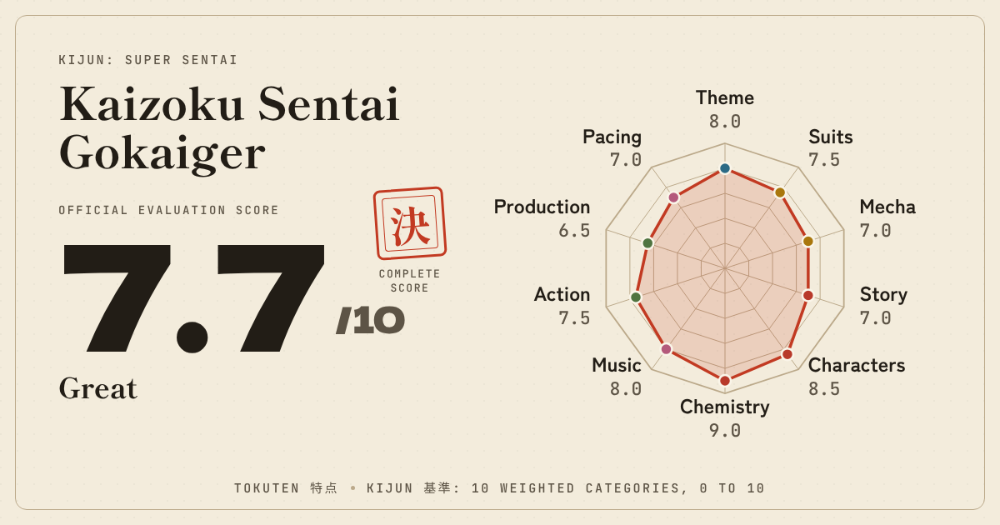
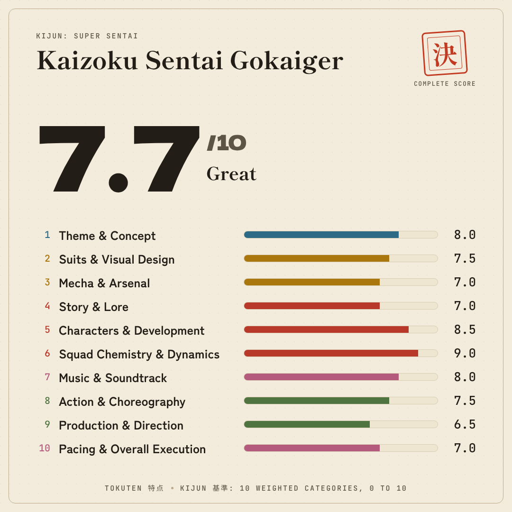
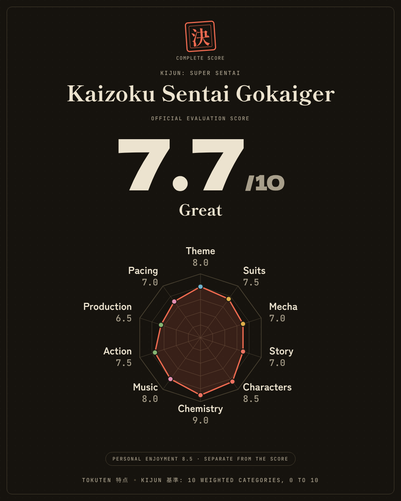

# 0010. Sharing a result

## Status

Accepted as a plan. The decisions below were agreed, and nothing is built yet.

## Context

The result card is the part of Tokuten people are most likely to want to show: the name of the season, the official score, what it means and the shape of the grades. Today the only ways out are Markdown and JSON, which are for keeping and for editing, not for showing.

The app has no server and should not get one (ADR 0001, ADR 0009). Anything that shares a result has to work with that, and has to be careful about what leaves the device.

## What is shared, and what is not

Shared by default: the name of the season, the profile, the official score and its reading, the seal that says whether the score is partial or decided, and the grade of each category.

Left out always: the introduction, the notes of each category and the conclusion. They are long, they are personal and they were written to be read in the app or in an export.

Opt in: personal enjoyment. It is shown as a separate line that says it is apart from the score, so the card keeps the rule of the method.

The image carries what is drawn on it and nothing else, so there is no hidden data in it.

## Options

### An image

The card is drawn in the browser and saved as a PNG. It can be downloaded, copied, or sent through the share sheet of a phone where the browser supports sharing files.

- Works in forums, chats and social networks, where a picture is accepted everywhere.
- Needs no server and puts nothing in an address.
- The picture cannot be opened back into the app, so it is for showing and not for continuing.

The card is drawn straight on a canvas, using the fonts the page has already loaded. That avoids a new dependency and avoids embedding fonts in an SVG. The Japanese glyphs the card needs are requested explicitly before drawing, because the font files are split by character range. Letter spacing on the small labels uses the canvas feature where it exists, and draws glyph by glyph where it does not.

### A link

The grades travel in the part of the address after `#`, which a browser never sends to a server. A results page reads it and draws the same card, read only, with a button to open the result in the app.

The payload is plain, versioned text, for example `1.sentai.8,7.5,7,7,8.5,9,8,7.5,6.5,7.e8.5.Title`: version, profile, ten grades in profile order (`n` for not applicable), optional enjoyment and the title. It is validated with the same kind of schema as the JSON import. Without compression it stays short and can be read by a person. The link holds grades and not the score, so the receiving side calculates the score with the same engine, and the two can never disagree.

- A person who gets the link sees the real card, in their own language, and can open it.
- A link preview in a social network would only show a generic image, because drawing a card per link needs a server. A single generic preview image is added to the site.
- Anyone who has the link can read what is in it. The card shows the same data as the image, so nothing new is exposed, but it is a link and it travels.

### Both

The image comes first because it works everywhere and is the simpler of the two. The link follows, and it reuses the same card drawing.

## Decision

1. A **Results** page at `/results`, reached from a Share button on the score card. It shows the card at full size with the choices below it, and it is the place both ways of sharing live.
2. The **image first**, then the **link**. The link is a separate step, so the choice can be revisited.
3. **The person chooses the layout in a preview.** The page shows every layout as a small live preview. Selecting one shows it at full size. The choice is remembered, like the format of the Markdown export.
4. The card follows the theme of the app and can be switched to the other one in the preview.
5. Each layout has one fixed size, drawn the same on every screen.
6. The link payload is short, plain and readable text.
7. The image gets a ready made description for people who use it with a screen reader, which can be copied with one action.

## A card must be understood by someone who has never seen Tokuten

The person who receives a card does not know the app, the Kijun method or the kanji. The first drafts of the layouts used the formal numerals of the app (壱 弐 参 ...) on the radar. They are part of the identity inside the app, and on a card they are noise. The rules for every layout are:

- **Every axis, bar and row is named in plain words.** The radar labels each axis with a short name and its grade, for example "Story 7.0". Kanji are never the only way to tell a category apart.
- **Kanji are decoration with a word beside them.** The seal 決 (complete) or 仮 (partial) always has a caption in words next to it, such as "Complete score" or "Partial score".
- **One line says what the card is.** The footer reads, in the language of the card, "Kijun 基準: 10 weighted categories, 0 to 10". It names the method and the scale, so the number can be read without opening the app.
- **Text is large enough to survive a preview.** Chats show a card about 400 to 500 pixels wide, so the smallest text on a 1200 pixel card is about 24 pixels and the labels that carry information are not smaller. Small mono captions are limited to secondary text.
- **Detail is limited on purpose.** A layout that carries all ten grades uses short rows, not long sentences, so it stays readable at the size it is shown.

To make this possible each category gets a short name next to its full name, for example Theme, Suits, Mecha, Story, Characters, Chemistry, Music, Action, Production and Pacing. They live in the dictionaries, in every language, and a test checks that each exists.

## Card layouts

All three use the same data and the same visual language: the seal, the pillar colors and the fonts of the app. The values on them are sample values. The person picks one in the preview, so none has to win in advance.

### A. Seal, landscape 1200 by 630

Title, score and reading on the left, the seal with its caption, and a radar on the right with every axis named and graded. It is the size chats and social networks show best, so it is the default in the preview. It shows the shape of the season.

### B. Ledger, square 1080 by 1080

Title and score on top, then the ten grades with their full names and a bar in the color of each pillar. It needs no chart reading at all, so it is the clearest for someone new, and it works well in forums and feeds.

### C. Poster, portrait 1080 by 1350, dark

A centered layout with the seal on top, a very large score and a radar with named axes, here in the dark theme and with personal enjoyment turned on. Made for phone screens.

## States the card must handle

- **Partial score.** The seal shows 仮 instead of 決 and a short line says how many categories are graded.
- **Quick mode.** Same card. The grades per category come from the quick grades.
- **Not applicable categories.** Shown as a dash and left out of the radar, as in the app.
- **No title.** A muted Untitled season, as in the app.
- **Long title.** Up to two lines on the image, then an ellipsis. The full title stays in the link.
- **Nothing graded.** Sharing is not offered.

## Consequences

- Each category needs a short name in every language. This is also useful in the app, for tight spaces.
- The score card is already a component that does not depend on the rest of the page (version 0.7.2), so the page can reuse the same pieces of data.
- A small module holds the card drawing, split from the page so it can be tested with a fake canvas.
- Colors in the drawing come from one table that mirrors the CSS tokens, with a test that compares the two so they do not drift.
- The privacy rules above become tests: the drawing function receives only what is allowed on the card, so it cannot print the notes.

## Decided

1. Layouts: the person chooses in a preview. A and B first, C after.
2. A `/results` page.
3. The link is offered, as a step after the image.
4. The link is short, plain and readable text.

## Still to settle during the work

- The short names in each language. The proposed English ones are in the first paragraph above. Portuguese: Tema, Trajes, Mecha, Roteiro, Personagens, Química, Música, Ação, Produção and Ritmo.
- The exact wording of the caption under the seal and of the footer line, in each language.

## Plan

- **0.9.0.** The Results page with the layout preview, layouts A and B, download, copy and share, the privacy choices and the description for screen readers.
- **0.9.1.** Layout C.
- **0.10.0.** The link, the read only page and the generic preview image.
